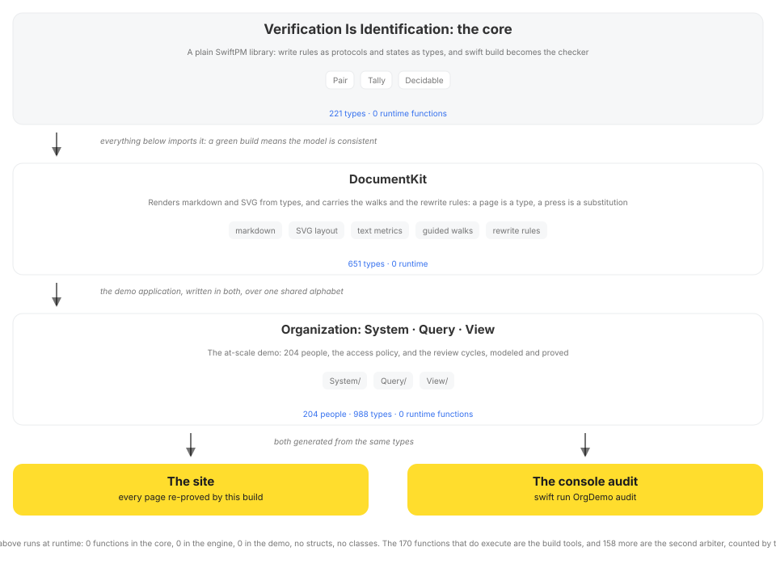

# Verification Is Identification

A saved check says a document met the requirement for an agent's next action. The document changes before that action. The record concerns the earlier source. Using it now requires grounds that connect the result to the current source and the original requirement. The [acquisition criterion](Sources/VerificationIsIdentification/VerificationIsIdentification.docc/Papers/acquisition_keeps_its_question.md) asks whether the retained grounds make the action adequate after the change.

## The criterion

This repository studies what given grounds determine and when a result can be used again. An answer is determined when compatible cases exist and all of them give that answer. The source can remain partly unknown. Determining the answer need not identify the complete source. This criterion names the repository: verification is identification. [Verification Is Identification](Sources/VerificationIsIdentification/VerificationIsIdentification.docc/Papers/verification_is_identification.md) states this criterion. The papers develop the arguments and their premises. The compiler checks the presented Swift constructions against their encoded relations. The [research loop](Sources/VerificationIsIdentification/VerificationIsIdentification.docc/VerificationIsIdentification.md) distinguishes a checked consequence, a refusal of the attempted construction and an open proof obligation. The company and its site demonstrate the notation.

## The discipline

The repository states how to record a result and what its continued use requires. It implements checks for specified relations between declarations.

A record states its question, its grounds and the scope of its answer. Proof status and execution status are kept apart, and when a premise loses support, the record calls for review of the uses that depended on it. [The result form](Sources/VerificationIsIdentification/VerificationIsIdentification.docc/Results.md) is that record.

A continuation after a change needs grounds that connect the old result to the new situation. The source may change instance, the access may be withdrawn, another participant may take over. The chosen continuation must still be available and still meet the original requirement in every case compatible with the complete input used to choose it, and its actual result must retain the residue and access the task requires. [Acquisition Keeps Its Question](Sources/VerificationIsIdentification/VerificationIsIdentification.docc/Papers/acquisition_keeps_its_question.md) states the condition and its boundary: the criterion does not supply or execute the action.

Agreement between records needs a checked relation. [`Sources/Court`](Sources/Court) reads supported declarations without using the Swift compiler for that reading. Each reader states which relations it checks. The company reader reports named refusals for its checked access assertions. The [gate](https://github.com/DanielSwift1992/gate) tool builds a judge from a pinned revision of this corpus for use in other repositories.

## How it is written

Swift protocols, associated types and constraints record relations in the notation. For a typed proof, [Law](Sources/VerificationIsIdentification/Law.swift) requires a construction deriving the claimed consequence from its supplied premises. The compiler checks the presented construction against its encoded relations. A refusal concerns that attempt and does not by itself establish the opposite claim. In the example below, a type instantiation presents an access assertion. The `judge` gate compares the company reader with the compiler on selected planted changes and checks the names in their refusals.


The demonstrated [policy rule](Sources/Organization/System/Policy.swift) permits a manager to administer documents in that manager's department.

The comparison uses implementations of this access condition. A check over values can evaluate an `if` or a guard when access is requested. The implementation below represents people, documents and requests as types. Its `where` clause requires an administrator rank and a matching department. `Granted` asks the compiler to establish that relation for the declared request:

```swift
public enum Carol: Employee {                     // a person is a type
    public typealias Rank = IndividualContributor
    public typealias Home = Finance
    // ...name, birth year, workplace: more of the same
}

public enum Administer<Who: Employee, Of: Doc> {}
extension Administer: Authorized                  // the rule is a `where` clause
where Who.Rank: CanAdmin, Who.Home == Of.Home {}

Granted<Administer<Alice, FinanceShare>>.self     // ✅ compiles: the access is proved
Granted<Administer<Carol, FinanceShare>>.self     // ❌ error: type 'Carol.Rank' (aka
                                                  //    'IndividualContributor') does not
                                                  //    conform to protocol 'CanAdmin'
```

`Granted` requires the declared request to conform to `Authorized`. The compiler refuses the shown request for Carol because its rank does not meet that requirement. This checks the written access assertion. It does not intercept requests to a running company's documents. The playground's **Plant a lie** button changes a declaration for its checker to read. Its At scale tab judges a 12,800-person file on every keystroke.

| Concept | Dynamic example | Guard over typed values | Typed request below |
| --- | --- | --- | --- |
| Data | a dict, shaped at runtime | a struct, shaped by the compiler | an empty `enum`: a pure type |
| A rule | an `if` | a guard over typed values | a `where` clause |
| A question | a call | a call | a type instantiation |
| A change of state | mutation | mutation, or a new value | a new type |
| A decision | at runtime | at runtime | at compile time |
| A green build means | the configured build checks passed | the declared type constraints are met | the written constructions satisfy their declared relations |

The comparison concerns the three implementations of this rule. It describes where each places the access check. A checked construction still needs grounds connecting its declarations to the system and requirement it represents. [Verification Is Identification](Sources/VerificationIsIdentification/VerificationIsIdentification.docc/Papers/verification_is_identification.md) states that obligation for changes of representation and continued use.

## Run the proof

```sh
git clone https://github.com/DanielSwift1992/verification-is-identification && cd verification-is-identification && swift build
```

The package ships a worked system: a 204-person company, its access policy, and its whole intranet site, all written as types. A green build checks its concrete and generic constructions against their declared type relations. Each proof derives its conclusion from the source-bound construction. In a local measurement on a 14-core Apple M4 Pro, a clean build took about eight minutes. Rebuilding after a comment-only edit to the policy took about ten seconds. Four things to try:

- Break a rule in [`Sources/Organization/System/Policy.swift`](Sources/Organization/System/Policy.swift) and rebuild. The error names what you broke.
- `swift test` runs the worked demos: two from physics (ice's residual entropy, hydrogen's spectrum) and a task scheduler. It prints "Executed 19 tests". The trailing "0 tests" line is expected: the newer Swift Testing harness finds no `@Test` functions there.
- `swift build -Xswiftc -DSHOW_UNSAT` rejects an impossible schedule by name. `-DSHOW_FORBIDDEN` rejects a forbidden spectral line. `-DSHOW_METAMER_SPLIT` splits a metameric pair of lights: the refusal names the infrared slot no eye reads.
- `swift run Tools site` builds and serves the whole documentation site locally.

For a research proof about acquired knowledge, see [When does a new question require a new observation?](Sources/Examples/Examples.docc/KnowledgeClosure.md). Run `bash Checks/verdict.sh knowledgeclosure` to check one resident acquisition chain, reuse of old memory, a necessary new reading and closure under its declared coordinate exchanges.

## The evidence

**The papers.** The 35 papers develop the arguments and their premises, in [`Papers`](Sources/VerificationIsIdentification/VerificationIsIdentification.docc/Papers) and on [the documentation site](https://danielswift1992.github.io/verification-is-identification/documentation/verificationisidentification). [`Sources/VerificationIsIdentification`](Sources/VerificationIsIdentification) contains 199 protocols, one per claim. Each protocol records a relation, and [Law](Sources/VerificationIsIdentification/Law.swift) distinguishes that declaration from a construction deriving its conclusion. Start with [Verification Is Identification](Sources/VerificationIsIdentification/VerificationIsIdentification.docc/Papers/verification_is_identification.md) for the criterion and its first constructions.

**The constructions.** [`Sources/Examples`](Sources/Examples) carries the worked constructions the papers cite. [`Checks`](Checks) supplies positive witnesses and selected incompatible constructions with expected refusals. `bash Checks/verdict.sh acquisition` runs one family of them.

**The demonstration.** [`Sources/Organization`](Sources/Organization) is a company, its access policy and its intranet site, all as types, rendered by [`Sources/DocumentKit`](Sources/DocumentKit). It shows the notation at scale and adds no claim to the theory.

[](https://danielswift1992.github.io/typed-playground/)

[The playground](https://danielswift1992.github.io/typed-playground/) shows Swift declarations on the left and the page they draw on the right. Its checker reports the supported relations that a declaration fails as you type. The playground uses a stated subset of Swift, and its [checks](https://github.com/DanielSwift1992/typed-playground#the-checks) describe the scope of that reading. It is a static page with no installation or application server.


The `Organization` target is the showcase. Its types declare the 204 people, the access policy, and the company's dashboard, catalogs, reports, personal cards and keypad logins. The compiler checks the presented type relations and access assertions. `swift run Tools site` builds and serves the documentation. The [guided walks](Sources/Organization/Wayfinding.swift) present branches of declared trees as links. Within their declared directories, the walks reach any page in four choices, and any of the 204 people in eight. The reader supplies the choice at each branch.

The site is rendered ahead of time, every page of it. Four of the employee cards carry a login keypad, as the demonstration. A key press follows a link to the next state. The state `k2` names two correct digits so far, and the URL fragment stores it. A wrong digit at any position lands in one shared dead state, so the 9⁴ = 6561 possible input sequences need five states. The last correct digit is a link to the unlocked page. [SecretPage](Sources/Organization/View/Card.swift) requires the supplied secret type to equal the page's declared secret. That equality is checked at compilation. It does not record which digits a visitor entered. The pages are static files, the site prints each password on its card, and the unlocked address can be opened directly. Access assertions for the 204 people use their declared rank, department and owner relations.

[](https://danielswift1992.github.io/verification-is-identification/documentation/organization)

The diagram is generated by the build it describes. The layout is computed from the same types the pages use. Every label is fitted by its measured width. The counts on each box come from this build. The [Curve](https://danielswift1992.github.io/verification-is-identification/documentation/verificationisidentification/curve) page has the measurement: build time against company size, to 12,800 employees.

This is a bounded rendering of declared states. It shows the notation carrying a whole organisation and its site. It says nothing about a system whose states were not declared.

## What the build proves

The company example declares a bounded family of states. A generic constructor can describe an infinite family, and a generic proof can cover its admitted substitutions without enumeration. An answer is determined when compatible cases exist and all of them give that answer. The cases need not be identical. Identifying a complete candidate is the special case in which only that candidate remains compatible. [Verification Is Identification](Sources/VerificationIsIdentification/VerificationIsIdentification.docc/Papers/verification_is_identification.md) states the criterion and the grounds needed to apply it to the intended source.

A construction can express a change through relations between its input and output. [Law](Sources/VerificationIsIdentification/Law.swift) requires a witness for the claimed consequence. Type syntax alone supplies no termination argument for an arbitrary recursive construction. In the company demonstration, pages and fragments represent declared states, and links represent actions. The generator and renderer execute to produce those files, and the browser follows the links.

An answer derived from the written input and type relations is available at build time. A finite source file does not make every semantic question decidable. The worked constructors show what their actual fields force, and the refusal checks attempt nearby incompatible constructions. General mathematical claims and their premises are developed in the papers.

The build checks the presented type relations. Applying a checked consequence to an actual system requires grounds connecting its premises and conclusion to the source and original question. [Verification Is Identification](Sources/VerificationIsIdentification/VerificationIsIdentification.docc/Papers/verification_is_identification.md) states that transfer obligation. [Results](Sources/VerificationIsIdentification/VerificationIsIdentification.docc/Results.md) records the derivation, its reach and the conditions of continued use, with proof and execution status kept separate.

*A checked construction derives its conclusion under its stated premises.*

## If you come from AI safety

Start with [Acquisition Keeps Its Question](Sources/VerificationIsIdentification/VerificationIsIdentification.docc/Papers/acquisition_keeps_its_question.md): the criterion applied to action, its examples, and the boundary between an adequate choice and an executed action. What this establishes: compilation checks encoded constructions under their stated premises. Application to an actual system also needs grounds for the source relation, the supplied operations and the coverage of the represented cases. The papers and constructions do not by themselves provide a system that approves an agent's next action or establish the safety of a deployed agent.

## The map

[`Sources/VerificationIsIdentification`](Sources/VerificationIsIdentification) contains 199 protocols, one per claim. Protocol requirements state relations. [Law](Sources/VerificationIsIdentification/Law.swift) distinguishes those declarations from constructors that derive their conclusions. The theory prints its dependency map, [the atlas](https://danielswift1992.github.io/verification-is-identification/documentation/verificationisidentification/atlas/): one row per claim, the most depended-on first.

[`Acquisition.swift`](Sources/Examples/Acquisition.swift) expresses recording and evidence refinement through generic constructors. Retained access needs only `AnswerInTrace`: a constrained name for the certificate's existing decoder. Its source and memory must fit, and its entire reading type is already present. No application object or runtime evaluator supplies the answer. [`Checks/Acquisition.swift`](Checks/Acquisition.swift) presents the generic consequences and nearby false constructions.

Run `bash Checks/verdict.sh acquisition` for the acquisition proofs and fourteen named refusals, `./check.sh --only verdict` when shared proof relations change, or `./check.sh` for integration. Mathematical arguments state their premises and derivations in the corpus. Optional experiments and their results belong under `Checks` and `Research`, and run separately with `./check.sh --research-only`. They do not gate publication of the theory. The deletion report is also a separate experiment: `./check.sh --only ablation` checks its recorded premise list when explicitly requested. A normal edit does not require a new deletion sweep.

[`Sources/Court`](Sources/Court) supplies readers for specified declaration fragments. The `judge` gate compares the company reader with the compiler on selected planted changes and checks the names in their refusals. [`Sources/Organization`](Sources/Organization) is the showcase: 204 people, the access policy, and the whole site as types. Files named `Generated*` are build products. Read the policy, not the generated people. [`Sources/DocumentKit`](Sources/DocumentKit) is the engine: pages, tables, SVG, and text metrics, written in the notation it renders.

The 35 papers derive the theory step by step. They are in [`Papers`](Sources/VerificationIsIdentification/VerificationIsIdentification.docc/Papers) and render into [the documentation site](https://danielswift1992.github.io/verification-is-identification/documentation/verificationisidentification).

## The gates

The repository checks itself. Each command is a gate. Green is a pass:

- `swift build` type-checks the whole system. The LawCheck plugin lints the engine and the company as it builds. A violation refuses the build by name.
- `swift run Tools grammar` re-states every source file in a typed vocabulary for the compiler to judge. A style violation is a compile error that names its rule.
- `swift run Tools lint Sources/VerificationIsIdentification --docc Sources/VerificationIsIdentification/VerificationIsIdentification.docc --strict` checks the theory against its law: pure types, every opened axis closed, no protocol that renames another, including one intersection of parents under two names, and every paper tag resolved to its paper.
- `swift run Tools readme` checks the registered count claims on this page against the source files and documentation that own them. The gate names a missing or mismatched claim.
- `swift run Tools census` counts source declarations per target: zero structs, zero classes, and zero functions classified as runtime across the theory, engine, and company rows. [Census.swift](Sources/Tools/Census.swift) defines that classification. It counts declarations rather than measuring execution.
- `swift run Tools judge diff 200` sets a second, independent checker beside the compiler. Four lies are planted in the generated company. Both checkers must refuse each one and name the same facts.
- `swift package --allow-writing-to-package-directory tree-sort check` checks that the docs' topic tree and the atlas match the type structure.
- `swift package --allow-writing-to-package-directory generate` regenerates the employees, the walks, the logins, and the card art: in Swift, in-repo.

## Documentation

The whole site is generated from this package. The 35 papers build the theory step by step. Two of them say where it ends: in a fixed task domain with a common finite rule interpretation, a system that only checks comes to represent every rule class once sound retaining insertions have stored a solved task of each class, and the distance between two such systems is measurable.

- **[VerificationIsIdentification](https://danielswift1992.github.io/verification-is-identification/documentation/verificationisidentification)** has the framework: the protocols, the papers, [the atlas](https://danielswift1992.github.io/verification-is-identification/documentation/verificationisidentification/atlas/).
- **[Examples](https://danielswift1992.github.io/verification-is-identification/documentation/examples)** applies it: the physics demos and a working solver.
- **[Organization](https://danielswift1992.github.io/verification-is-identification/documentation/organization)** scales the demonstration: a company declared as types, with checked access assertions and pages rendered from those declarations.
- **[DocumentKit](https://danielswift1992.github.io/verification-is-identification/documentation/documentkit)** carries the rendering engine and the guided walks, written in the notation they render.
- **[GrammarLexicon](https://danielswift1992.github.io/verification-is-identification/documentation/grammarlexicon)** is the style linter's vocabulary: the words, scopes, and grants sources are judged in.
- **[Alphabet](https://danielswift1992.github.io/verification-is-identification/documentation/alphabet)** has one atom per character, shared by the renderer and the linter.

## License

MIT
