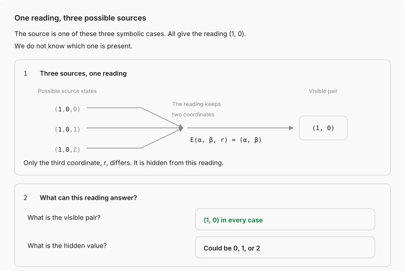
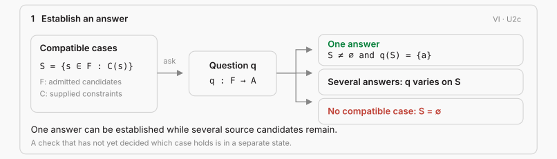
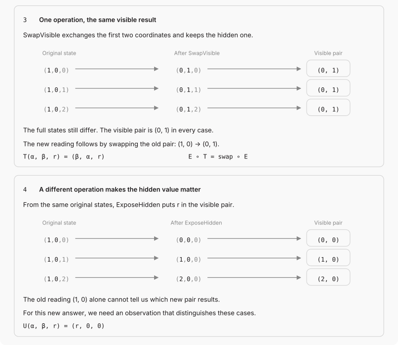
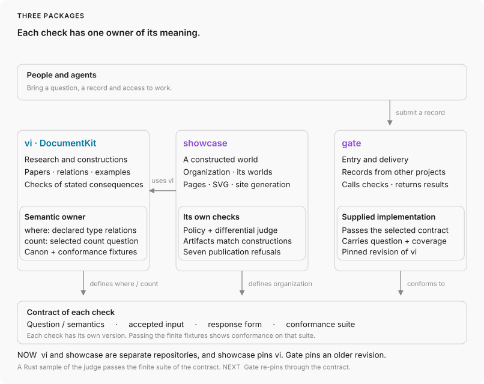

# Verification Is Identification

Different visible spectra can produce the same colour reading for a specified observer under fixed conditions. This is metamerism. That reading alone does not identify the spectrum. Some questions about the source can still be answered exactly, and some operations on it can still be chosen with grounds.

This repository studies that situation in general: what a partial view of an unknown source determines, which actions it supports before the source is identified, and what the result must keep for whoever continues the work. The arguments are in 35 papers. The part written as Swift types is checked by the compiler, and a second reader checks a fragment of it separately.

Start with [Verification Is Identification](https://danielswift1992.github.io/verification-is-identification/documentation/verificationisidentification/verification_is_identification/) for the criterion, the constructions and their connection to the source being studied.

## One observation, two questions

Metamerism is one case of a more general situation: different sources give the same observation and still differ in ways that matter for other questions. A symbolic model in [`Light.swift`](Sources/Examples/Light.swift) and [`Verdict.swift`](Sources/Examples/Verdict.swift) isolates that situation. Three declared sources, `RedBeam`, `RedBeamWithIR` and `RedBeamWithMoreIR`, have the same visible coordinates and different infrared coordinates. `EyeImage` reads only the visible coordinates. The infrared coordinate remains part of each source. [Seeing Is Encoding](https://danielswift1992.github.io/verification-is-identification/documentation/verificationisidentification/seeing_is_encoding/) also derives a model in which every source channel contributes to the reading, and states the calibration and measurement conditions a physical test would need.



The visible record answers one question and not another. It determines the visible pair. It does not determine the infrared coordinate, because the three sources differ there.

An answer is determined when the cases compatible with the grounds exist and all of them give that answer. To verify an answer to a question is to identify that answer. Several sources can remain compatible while the answer is determined, and identifying the whole source is the special case where the question asks for the whole source. [Verification Is Identification, U2c](https://danielswift1992.github.io/verification-is-identification/documentation/verificationisidentification/verification_is_identification/) states it, and its constructions go on to derive new relations among fields that are still unknown.

<details>
<summary>When an answer is determined</summary>



</details>

## Acting before the source is known

Take the same three sources. `SwapVisible` exchanges the two visible coordinates and keeps the infrared. The new eye image is the swap of the old one, so the old record still answers the new visible question. `ExposeHidden` moves the infrared into a visible coordinate, and after it the three sources give three different eye images. The old record is still true about the state it was taken from. It no longer determines the new answer.



The construction is `ThreeBeamVerdict` with `SwapVisible`, `SwapFactors` and `ExposeHidden`, and the [source map](Documentation/Figures/beam-study-sources.md) gives the definitions, the general argument and the positive and negative checks of each frame. These operations are symbolic. Applying them to light requires a physical operation and a connection to the source.

[Acquisition Keeps Its Question](https://danielswift1992.github.io/verification-is-identification/documentation/verificationisidentification/acquisition_keeps_its_question/) states the condition for any operation. A supplied operation may act on unknown contents when its laws establish the required effect, and choosing it needs grounds that it works in every case compatible with the complete input used for the choice. Its actual output has to keep what the task requires and give the continuation the access it needs, and a task that must finish also needs a completion argument. Unknown content can take part in the action without being identified first.

<details>
<summary>When a continuation is adequate</summary>


</details>

The source can change after a check, access can be withdrawn, or another participant can take over. Continued use then needs a justified connection between the original requirement, the retained answer and the state actually reached. The [result form](https://danielswift1992.github.io/verification-is-identification/documentation/verificationisidentification/results/) records the question, source, premises, derivation, reach, actual result and next use, with proof status and execution status as separate fields. When a premise loses support, the uses that depend on it are reviewed, and other valid grounds may still support them. An agent workflow meets this at every handoff: an agent checked a document, the document changed, and the next action needs grounds both for the source relation and for the execution.

## What is known and what is built here

This question has been studied in several forms. In incomplete databases, certain answers are tuples returned by a query in every database consistent with the recorded information (Imielinski and Lipski, 1984). Dong, Halevy and Yu (2009) study query answering under uncertain schema mappings. For a Boolean question over a nonempty admissible class, truth throughout, falsity throughout and indeterminacy when the cases disagree follow the supervaluationist pattern (van Fraassen, 1966, Fine, 1975). Indeterminacy here is a verdict, not a third truth value. Nash, Segoufin and Vianu (2010) distinguish semantic determinacy from rewriting in a chosen language. [Verdict Is Invariant](https://danielswift1992.github.io/verification-is-identification/documentation/verificationisidentification/verdict_is_invariant/) discusses these connections, and [The neighbors](https://danielswift1992.github.io/verification-is-identification/documentation/verificationisidentification/neighbors/) compares the package with partial evaluation, materialized Datalog, total languages, automaton minimization and policy engines.

What is built and checked here:

- The action law above, with what a continuation must keep after the source, the access or the participant changes.
- A typed record of the research: 199 protocols, one per claim, with constructions the compiler checks and expected refusals that must keep failing.
- A second reader that names what it refuses, and a finite contract against which another implementation of that reader is checked.
- Worked models, among them the three sources above and the company of the showcase package.

They do not establish that the second reader agrees with the compiler, or with another implementation of it, on every Swift text, that a symbolic operation is a physical one, or priority over the work cited above.

## From a claim to a checked construction

A protocol states a relation. A proof is a construction that derives the conclusion from supplied premises. [Law.swift](Sources/VerificationIsIdentification/Law.swift) requires such a construction for the typed proofs, and the compiler checks it against the encoded relations. A failed construction is a defect of that attempt. A claim without a construction has an open proof obligation.

```text
question and grounds → proposed construction → check
                                               → established consequence
                                               → addressed refusal
                                               → open proof obligation
```

The next step starts from the result and its grounds. A changed representation must connect the question back to the intended source. An action must produce the actual result the continuation requires. A successful type check establishes the encoded consequences under their premises, and applying them to an actual system also requires the source connection.

Worked constructions are in [`Sources/Examples`](Sources/Examples), positive witnesses and expected refusals in [`Checks`](Checks), and the [atlas](https://danielswift1992.github.io/verification-is-identification/documentation/verificationisidentification/atlas/) maps the dependencies between claims. To check a construction locally:

```sh
git clone https://github.com/DanielSwift1992/verification-is-identification
cd verification-is-identification
swift build --target Examples
bash Checks/verdict.sh acquisition
bash Checks/verdict.sh knowledgeclosure
```

The acquisition checks run a family of generic consequences and nearby constructions that must fail. [When does a new question require a new observation?](https://danielswift1992.github.io/verification-is-identification/documentation/examples/knowledgeclosure/) is a worked chain: old memory answers one question, and the next question requires a new reading.

## A second reader, and gate

[`Sources/Court`](Sources/Court) is a second reader, separate from the Swift compiler, for specified fragments of declarations. A verdict applies to the fragment the reader supports and to the obligations it examined. A form outside that fragment must receive a refusal that names it.

[gate](https://github.com/DanielSwift1992/gate) is another kind of application. It uses a judge built from a pinned revision of this corpus to check declarations imported from records such as ownership files. Other commands inspect API contracts and their clients under separate contracts. The contract of each command defines what its result means.



## The worked application

The [showcase package](https://github.com/DanielSwift1992/verification-is-identification-showcase) declares a company, its access policy and its intranet website as types, and the compiler checks the declared access requests against the policy. Its [company site](https://danielswift1992.github.io/verification-is-identification-showcase/documentation/organization/) presents the result, and [DocumentKit](https://danielswift1992.github.io/verification-is-identification-showcase/documentation/documentkit/) renders the pages from types. The company is a declared world: the checked access assertions are about its declarations. The showcase runs this package's `Tools` and `LawCheck`, and its [package diagram](https://github.com/DanielSwift1992/verification-is-identification-showcase/blob/main/Sources/Organization/Organization.docc/Resources/architecture.svg) shows the application and its generated representations.

[Open the playground](https://danielswift1992.github.io/typed-playground/) to edit declarations and see the page they describe. [Its checks](https://github.com/DanielSwift1992/typed-playground#the-checks) document the supported subset of Swift.

## Read and work in the repository

| Part | Read | Work with the source |
| --- | --- | --- |
| Research and notation | [Framework and papers](https://danielswift1992.github.io/verification-is-identification/documentation/verificationisidentification/), [dependency atlas](https://danielswift1992.github.io/verification-is-identification/documentation/verificationisidentification/atlas/) | [`VerificationIsIdentification`](Sources/VerificationIsIdentification), [`Examples`](Sources/Examples), [`Checks`](Checks) |
| Worked constructions | [Examples](https://danielswift1992.github.io/verification-is-identification/documentation/examples/) | [`Sources/Examples`](Sources/Examples) |
| Readers | Contracts stated by each reader | [`Sources/Court`](Sources/Court), [gate](https://github.com/DanielSwift1992/gate) |
| Company and rendering | [Organization](https://danielswift1992.github.io/verification-is-identification-showcase/documentation/organization/), [DocumentKit](https://danielswift1992.github.io/verification-is-identification-showcase/documentation/documentkit/) | [showcase package](https://github.com/DanielSwift1992/verification-is-identification-showcase) |

`swift build` checks the whole package. `swift test` runs the worked demos and source-reader controls and prints "Executed 20 tests". `swift run Tools site` builds and serves the documentation locally. [`check.sh`](check.sh) lists the repository's checks: `./check.sh --only verdict` runs the registered proof and refusal fixtures, `./check.sh` runs the integration checks, and `swift run Tools readme` compares the counts on this page with their source artifacts. Optional research experiments run separately with `./check.sh --research-only`.

## License

MIT
